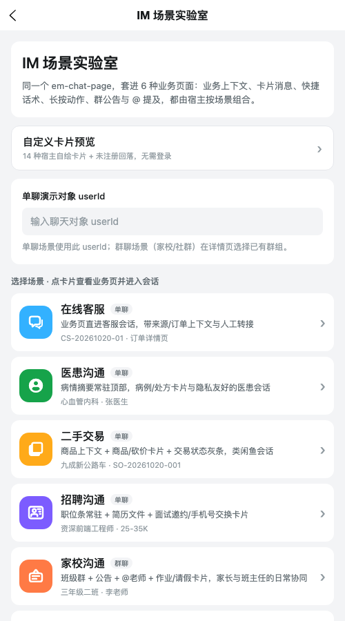

# easemob-uikit-uniapp

环信 IM 的 uni-app 版 UIKit（uni-app x 蒸汽模式），面向 DCloud 插件市场社区分发。MIT 开源。

> **仅支持 uni-app x 蒸汽模式（Vapor）**：DCloud 官方已于 2024 年停止 nvue 与 5+ 维护，并将于 2027 年初停止 uni-app App 平台与 uni-app x vdom 平台维护（依据见 [DCloud 官方文档 · FAQ「老 uni-app 还维护吗？」](https://doc.dcloud.net.cn/uni-app-x/)）；uni-app x 蒸汽模式已兼容 js/ts 写法，老 uni-app 工程可直接升级。本插件不提供经典 uni-app（Vue2/Vue3、nvue、vdom 模式）兼容，五端均基于 uni-app x 蒸汽编译目标。详见 [docs/PLATFORM.md](./docs/PLATFORM.md)。

> 当前版本：**1.0.6**。首个正式版本包含单聊、群聊、联系人、多场景扩展与 AI 流式消息；能力边界与已知限制见下文。接入步骤见 [docs/QUICKSTART.md](./docs/QUICKSTART.md)，版本变更见 [更新日志](./uni_modules/easemob-uikit-uni/changelog.md)。

## 兼容性

| 项 | 要求 |
|---|---|
| HBuilderX | **5.21+**（推荐 5.26+；蒸汽模式硬性要求） |
| uni-app x | HBuilderX 4.71+ |
| Node.js | 18+（CLI 编译用） |
| 环信 SDK | `easemob-websdk` **5.2.0**（peer 依赖） |
| App | Android 6+ / iOS 15+ / 鸿蒙 API20+ |
| H5 | 现代浏览器（移动端布局；未做 PC 宽屏） |
| 小程序 | 微信小程序（SDK 需分包接入） |

## 初始化生命周期

- `EmKit.init()` 在**每个应用进程内只生效一次**，`appkey` 初始化后固定；`logout()` 后直接重新 `login()` 即可，不需要再次 `init()`。
- 需要切换 appkey（多租户/多环境）时，请重启应用进程或重建页面栈；SDK 未提供 ChatClient 销毁接口，UIKit 不提供 `destroy()`。
- 小程序端 SDK 分包加载失败后，UIKit 会清空初始化缓存，修正分包配置后可重新 `init()`。

## 仓库结构

```
uni_modules/easemob-uikit-uni/   # UIKit 插件本体（组件前缀 em-）
demo/                            # 演示工程（uni-app x，manifest.json 开启 vapor）
templates/chat-only/             # 可运行单聊天模板（web/mp 构建门禁）
docs/                            # 文档（含 SDK 五端连通性 spike 记录）
skills/                          # 宿主接入 Agent Skills（分发给接入方 AI）
scripts/                         # 编译/发布脚本
```



## 接入路径

| 目标 | 入口 |
|---|---|
| 只要一个单聊天页 | [可运行 `templates/chat-only`](./templates/chat-only/README.md)：含登录恢复、聊天页、小程序分包和构建检查 |
| 完整 IM | 按下方快速开始，页面组合参考 `demo/` |
| 业务页直进单聊 | 使用 chat-only，或阅读 [多场景接入](./docs/GUIDE-MULTI-SCENARIO.md) |

## 快速开始（宿主接入）

完整步骤（空工程 → 登录 → 会话列表 → 聊天页 → 五端运行 → 排错）见 **[docs/QUICKSTART.md](./docs/QUICKSTART.md)**。最短路径：

1. `npm install easemob-websdk@5.2.0`，把 `uni_modules/easemob-uikit-uni/` 放入宿主工程；
2. `pages.json` 补页面组件 easycom 规则，聊天页/详情页设 `navigationStyle: "custom"`；
3. `App.uvue` 的 `onLaunch` 调 `initTheme()` + `EmKit.init({ appkey, onTokenWillExpire })`；
4. 宿主服务端签发 token，登录页调 `await EmKit.login({ userId, token })` 后 `reLaunch` 到会话页；
5. 会话页根节点 `height: 100%`；页面组件默认 `autoSync` 首次自拉，`onShow` 再调 `EmKit.syncConversations()` 补刷新；
6. 点击会话 `navigateTo` 聊天页，传 `conversationId` 与 `chatType`（`singleChat` / `groupChat`）；
7. 微信小程序按 [SDK 分包指引](./docs/GUIDE-WEAPP-SDK-SUBPACKAGE.md) 接入 `sub-sdk`；
8. 真机/开发者工具分别跑 Android、iOS、鸿蒙、H5、微信小程序；
9. 遇到空白页先检查页面高度链与 `navigationStyle`。

> 常见错误：页面根节点没有确定高度 → 列表/输入栏 0 高；聊天页未关原生导航 → 双导航栏；小程序未接分包 → `module 'sub-sdk/im-sdk.js' is not defined`。

## AI 接入（Agent Skills）

仓库 [`skills/`](./skills/README.md) 提供 8 份**面向宿主接入方**的 Agent Skills：总纲、会话/聊天页、通讯录/群组、业务卡片扩展、AI 流式、主题/i18n、小程序 SDK 分包、排错。每份 `SKILL.md` 含触发条件、可复制代码、组件契约与验收清单。

```bash
# 复制到宿主工程（Claude Code / 通用 Agent Skills 约定）
cp -R skills/em-host-* your-app/.claude/skills/
cp -R skills/em-host-* your-app/.agents/skills/
```

也可以不复制，直接把目录指给 AI：**「按 `skills/em-host-integration/SKILL.md` 接入环信 IM」**。技能地图与推荐用法见 [`skills/README.md`](./skills/README.md)；技能结构可跑 `node scripts/check-skills.mjs` 校验。

> `skills/` 是给**接入方**的；`.agents/skills/` 是给 **UIKit 贡献者**的开发技能，两者不要混用。

## 最小连通性验证（仓库 demo）

最小用例是 `demo/pages/spike/spike.vue`：手填 appkey/userId/token 登录环信，给指定 peer 发文本消息并显示收发流，用于验证 SDK 各端连通性。

方式一（HBuilder）：用 HBuilderX / HBuilder V 打开 `demo/` 目录，运行到浏览器 / 微信开发者工具 / 真机。

方式二（CLI，走 HBuilderX 内置编译器）：

```bash
cd demo && npm install        # 安装 easemob-websdk
cd ..
scripts/uni.sh build web      # H5 出包
scripts/uni.sh build mp-weixin # 微信小程序出包（用微信开发者工具打开 demo/unpackage/dist/build/mp-weixin）
# H5 本地验证：dev 模式暂不支持 .uts 入口，用构建产物 + 静态伺服
cd demo/unpackage/dist/build/web && python3 -m http.server 5180
```

> appkey 与测试 token 从环信控制台获取（仅限开发用途），**不要**把真实凭据提交进仓库。

## 未读角标 / tabBar（响应式）

UIKit 对外暴露两个响应式未读数，口径与 vue 版一致：

- `conversationUnread`：所有会话 `unreadCount` 之和（含免打扰会话）
- `contactRequestUnread`：收到的、仍 pending 的好友申请/群邀请（我方发出后被处理的通知不计）

```ts
import { onShow } from '@dcloudio/uni-app'
import { useUnreadCounts, useTabBarBadge, useConversationUnreadCount } from '@/uni_modules/easemob-uikit-uni/libs'

// 1) 只取响应式数值，自定义 tabbar / 页面红点：
const { conversationUnread, contactRequestUnread } = useUnreadCounts()

// 2) 原生 tabBar 角标（在任一 tab 页 setup 调用一次；tab 页常驻，切换 tab 后仍持续更新）：
const tabBarBadge = useTabBarBadge({ conversationIndex: 0, contactIndex: 1 })
onShow(() => tabBarBadge.sync()) // 从聊天页返回 tab 页时补同步（平台要求当前页必须是 tabBar 页）

// 3) 单会话未读（业务入口角标）：
const peerUnread = useConversationUnreadCount(peerUserId)
```

- 非 setup 场景（App onLaunch、原生回调）用 `getUnreadCounts()` 取快照，或 `EmKit.conversationUnreadCount` / `EmKit.contactRequestUnreadCount` getter；单会话快照用 `EmKit.conversationUnreadCountOf(conversationId)`。
- 角标封顶默认 99（显示 `99+`），可通过 `maxCount` 调整；`enabled: false` 可整体关闭。
- 自定义 tabbar 直接用 `em-icon` + `em-badge` 渲染 computed 值，不依赖 `uni.setTabBarBadge`。
- 原生 tabBar 的 `iconPath` 只接受图片（平台限制），demo 用 `scripts/build-tabbar-icons.py` 从 `em-icons.ttf` 同源字形生成 81×81 PNG（`demo/static/tabbar/`）；组件内图标仍统一用 `em-icon` 字体。
- 聊天页内会按会话合批清服务端未读（`tabs` 角标不复活）；宿主自定义入口读完消息可用 `EmKit.clearConversationUnread(conversationId, chatType)` 兜底（本地立即归零 + 服务端异步清）。

## Token 续期与连接状态（1.0）

长连接会经历 Token 到期、断线重连、被踢/设备超限。UIKit 已接 SDK 生命周期事件，宿主只需按需提供续期回调：

```ts
EmKit.init({
  appkey: 'your-appkey',
  // Token 约 80% 生命周期时触发；返回新 token，UIKit 自动 client.renewToken(token)
  onTokenWillExpire: async () => {
    const res = await fetch('/api/im/token')       // 宿主服务端签发
    return (await res.json()).token
  },
  // 已过期（SDK 已断开）：通常跳登录页
  onTokenExpired: () => uni.reLaunch({ url: '/pages/login/login' })
})

// 也可在任意时刻手动续期：
await EmKit.renewToken(newToken)
```

连接状态统一在 `EmKit.state`（响应式）：

| 字段 | 说明 |
|---|---|
| `status` | `idle` / `connecting` / `reconnecting` / `online` / `closed`（`CONNECTION_STATUS.RECONNECTING` 为自动重连中） |
| `reason` | 最近一次连接事件原因（SDK 原值：`login` / `reconnect` / `offline` / `token-expired` / `limit` …） |
| `errorCode` | 最近一次断开/重连失败错误码，0 = 无 |
| `reconnecting` / `reconnectAttempt` | 是否重连中 / 当前重连次数 |

UIKit 已在 `em-conversation-page` / `em-chat-page` 顶部内置连接状态条（`em-connection-banner`）：`connecting/reconnecting` 显示「正在连接/重连」，`closed` 按 `reason` 显示网络异常、设备超限或 Token 过期。宿主可用 `:show-connection-banner="false"` 关闭，自行渲染 `EmKit.state`；被踢/设备超限时 `reason` 会透出，建议引导重新登录。

## 多场景扩展（业务直进会话）

客服 / 医疗 / 招聘 / 二手交易共享「业务页面放入口 → 直进 1v1 聊天页」模型，无需会话列表。可用扩展能力：

| 能力 | 用法 |
|---|---|
| 业务上下文 ext | `EmKit.sendText(to, chatType, text, quote?, mentions?, ext?)`，对端从 `message.ext` 读取 |
| 卡片消息 | `EmKit.sendCustom(to, chatType, event, params?, ext?)` 发送；渲染走 `#custom-message` 插槽（作用域 `message`），**UIKit 不内置卡片组件/样式**，整卡由宿主自绘 |
| 卡片数据 | `message.customEvent` / `customParams` / `ext` 原样透出；宿主按自己的 event 分发，未知 event 自行兜底 |
| 卡片动作 | 宿主卡片内部按钮自己 `emit`/跳转即可，不经过 UIKit；Demo 的 `demo-card` 是参考实现（14 种卡片 + 双动作 + 脱敏） |
| 输入栏发卡入口 | `em-chat-page` 的 `#input-toolbar` 插槽（输入栏上方固定位）；宿主自绘「发订单/发病例/换手机号」等胶囊，点击自行 `sendCustom` |
| 顶部业务条 | `em-chat-page` 的 `#banner` 插槽（固定位，不随消息滚动）；`title` / `showAction` 控制标题与详情入口 |
| 系统提示灰条 | `EmKit.insertLocalNotice(conversationId, chatType, text)`（只插本地，不发服务端） |
| 单会话未读 | `useConversationUnreadCount(conversationId)`（响应式）/ `EmKit.conversationUnreadCountOf(id)`（快照） |
| 快捷回复 | `em-chat-page` 的 `quickReplies` + `quickReplyMode`（`fill` 填草稿 / `send` 直发） |
| 业务长按动作 | `em-chat-page` 的 `extraMessageMenus` + `@message-menu(key, message)` |

完整代码示例（easycom、init→login→navigateTo、四场景配方、平台边界）见 [docs/GUIDE-MULTI-SCENARIO.md](./docs/GUIDE-MULTI-SCENARIO.md)。

**demo 体验**：「我的」→「IM 场景实验室」→ 6 个场景卡片（在线客服/医患/二手交易/招聘/家校/兴趣社群）→ 业务详情页选对端或群组（页面底部可预览该场景的输入栏发卡入口）→ 进入会话后输入栏上方直接「发订单/发病例/换手机号」，也可用「场景开关」实时切换横幅/标题/详情入口/快捷回复/业务菜单/输入栏入口，并发送 14 种**宿主自绘**卡片、带 ext 文本与系统提示。列表页的「自定义卡片预览」无需登录，可直接看 14 种宿主卡片与「未知事件回落」。

## AI 流式消息（Stream Message）

对齐 vue 版「内核薄、插件厚」：**数据链路与纯文本流式渲染内置、零配置可用**；markdown 等富格式由宿主插槽接管。
典型场景：AI 客服 / IM 内 AI 对话 / 分段生成内容。流式内容由**业务服务端**经环信 RESTful 下发，客户端只收不发。

### 开箱即用能力

1. **分片合并**：`onStreamMessage` 按 `msgServerId` 把分片幂等合并进同一条 TEXT 气泡（`body.content = stream.fullText`），不产生多条气泡；
2. **丢片补偿**：离线/断连错过分片时，随后到达的完整消息（`onMessage`）覆盖未完成流式副本并收敛终态，不残留半截内容；
3. **纯文本流式状态**：传输中尾部打字机光标 → 终态收敛普通文本；`STREAM_ERROR` 尾部追加「内容生成异常」；
4. **高性能**：分片索引 O(1) 定位 + 按 `streamThrottle` 合批写 store（默认 50ms，≤20 次重绘/秒），终态立即落盘；聊天页跟随滚动独立节流（120ms），用户上翻时自动暂停；
5. **配置化**：`EmKitConfig.enableStreamMessage` 可关闭整条流式链路（等完整消息一次上屏），运行时用 `setConfig()` 切换。

### 接入代码

```ts
import { EmKit, setConfig } from '@/uni_modules/easemob-uikit-uni/libs'

EmKit.init({
  appkey: 'your-appkey',
  // 默认 true；false = 忽略 onStreamMessage 分片，等完整消息一次性上屏
  enableStreamMessage: true,
  // 分片合批间隔（ms），默认 50；0 = 逐片即写（高刷演示/调试）
  streamThrottle: 50
})
await EmKit.login({ userId, token })

// 可选：外部 AI 面板/埋点订阅流式更新（分片已合批，msg.stream 携带最新全文与状态）
const off = EmKit.onStreamMessage((msg) => {
  console.log(msg.conversationId, msg.stream?.status, msg.stream?.fullText)
})
// 页面 onUnmounted 必须 off()
```

消息上的流式元信息（`EmMessageItem.stream`，仅流式消息携带）：

| 字段 | 说明 |
|---|---|
| `fullText` | 截至当前分片的累计全文（与 `message.text` 同值） |
| `deltaText` | 当前分片增量（供自定义动画/统计，展示以 fullText 为准） |
| `status` | `STREAM_START` / `STREAM_IN_PROGRESS` / `STREAM_COMPLETED` / `STREAM_START_COMPLETED` / `STREAM_ERROR` |
| `customType` | 业务自定义流类型，如 `'text'` / `'markdown'` |
| `seq` / `errorType` / `finishReason` | 分片序号 / 错误码 / 服务端结束原因 |

### 富格式（markdown）由宿主接管

内核只渲染 `customType='text'`（含缺省）的纯文本流；`markdown` 等富格式经 `em-chat-page` 的 `#stream-message` 插槽接管（未提供插槽时纯文本兜底，内容仍随分片增长）：

```vue
<em-chat-page :conversation-id="id" :chat-type="chatType">
  <template #stream-message="{ message }">
    <my-markdown-bubble :message="message" />
  </template>
</em-chat-page>
```

### Demo 演示

- **聊天页「AI 演示」悬浮入口**：向当前会话注入 mock AI 流式回复（完成 / 异常 / 停止），演示光标与终态/异常；
- **「我的」→ AI 流式消息**：运行时开关 `enableStreamMessage`；
- **样式实验室 → AI 流式消息**：独立流式气泡演示（不依赖登录/会话），显示分片数与状态。

> 生产接入务必走**业务服务端代理**：服务端调用模型 → 经环信 RESTful 下发流式消息 → 客户端 `onStreamMessage` 接收；不要把模型 API Key 放到前端。

## 深色模式（默认跟随系统）

主题偏好三档 `auto | light | dark`，默认 `auto`：App 跟随系统深色（`osTheme`）、H5 跟随 `prefers-color-scheme`、微信小程序跟随宿主主题（`hostTheme`）；系统切换实时生效，用户手选档位持久化在设备本地（`emkit.themeMode`，不随登出清理）。

```ts
import { onShow } from '@dcloudio/uni-app'
import { initTheme, useTheme, syncNativeThemeUI, THEME_MODE } from '@/uni_modules/easemob-uikit-uni/libs'

// App.vue 的 onLaunch 调用一次（页面 setup 里 useTheme 也会兜底初始化）
initTheme({ tabBarPages: ['pages/conversation/conversation', 'pages/contact/contact', 'pages/mine/mine'] })

// 页面 setup：根节点绑定 themeClass（App 端无 :root，主题 class 必须挂根节点）
const { themeClass, themeStore, setTheme } = useTheme()
onShow(() => syncNativeThemeUI()) // 同步原生导航栏 / tabBar（主题变化时也要再调一次）

setTheme(THEME_MODE.DARK)   // 强制深色；setTheme(THEME_MODE.AUTO) 恢复跟随系统
themeStore.mode             // 解析后的实际主题：'light' | 'dark'
```

- **原生 chrome**：`syncNativeThemeUI()` 动态设置导航栏/tabBar 颜色；`tabBarPages` 命中当前页才会同步 tabBar（避免非 tab 页 API 报错）。
- **首帧不闪**：`pages.json` 用 `@变量` 引用 `theme.json`，并在 `manifest.json` 开 `mp-weixin.darkmode` / `web.darkmode`；App 配 `app.defaultAppTheme: 'auto'`（本仓库 demo 已接线）。
- **H5 限制**：H5 运行时没有 `setNavigationBarColor` / `setTabBarStyle`，内置导航栏/tabBar 由宿主接管（参考 `demo/index.html` 的 `html[data-em-theme] .uni-page-head` / `.uni-tabbar` 规则，以及 `demo/common/theme.ts` 的 `syncH5Chrome()` 选中态同步）。
- 宿主页面若自己实现主题切换，监听 `themeStore.mode` 后调 `syncNativeThemeUI()` 即可；`demo/common/theme.ts` 的 `useDemoTheme()` 是完整封装示例。

## 语言 / i18n

内置 `zh-CN` / `en`，默认优先读取本地偏好 `emkit.locale`，无偏好时跟随系统语言（英文环境用 `en`，其余 `zh-CN`）。模块加载时会自动 `initLocale()`，宿主也可显式指定：

```ts
import { EmKit, setLocale, getLocale, mergeMessages } from '@/uni_modules/easemob-uikit-uni/libs'

EmKit.init({ appkey: 'your-appkey', locale: 'en' }) // 初始化时指定并持久化
setLocale('zh-CN')                                  // 运行时切换（立即生效 + 持久化）
getLocale()                                         // 'zh-CN' | 'en'

// 注入/覆盖文案（新 locale 也可）
mergeMessages('en', { 'chat.placeholder': 'Type a message…' })
```

- 组件内文案统一走 `useLocale().t(key)`，缺 key 回退 `zh-CN`，再回退 key 本身。
- 语言偏好与主题偏好都存设备本地，不随登出清理。

## 日志与隐私

- `EmKitConfig.logLevel` 默认 `info`；`logPayload` 默认 `false`，**不会**把好友/群同步的原始 payload 写入日志缓冲。
- 需要排查同步/资料问题时显式开 `logLevel: 'debug', logPayload: true`；开启后日志可能包含 userId、昵称、群名等，导出前请脱敏，生产环境用完即关。
- `EmKit.exportLogs()` 导出内存环形缓冲（2000 行）；生产包建议不向终端用户暴露导出入口。

## 能力与边界

当前版本已提供：

- 单聊全链路：会话列表（置顶/免打扰/未读/草稿）、聊天页（文本/图片/语音/视频/文件、复合消息接收展示、引用/撤回/失败重发/已读回执/typing）、聊天详情、通讯录（好友列表/好友申请）
- **群组**：群列表、建群、群聊（公告条 / @ 提及 / 成员昵称行）、群详情管理（公告编辑 / 改名 / 管理员 / 转让 / 退群解散 / 全员禁言 / 成员管理 / 邀请入群）、联系人页入口化（新请求 / 群组 / 好友列表三入口）
- **多场景扩展**：`sendText` 业务 ext、`sendCustom` 自定义消息、`#banner` 顶部业务条、`title`/`showAction`、`insertLocalNotice` 系统提示灰条
- **多场景增强**：单会话未读 API、`em-quick-reply-bar` 快捷回复条、`extraMessageMenus` 业务长按动作
- **AI 流式消息**：`onStreamMessage` 分片合并/丢片补偿、纯文本打字机光标与异常提示、`enableStreamMessage`/`streamThrottle` 配置、`EmKit.onStreamMessage` 订阅、`#stream-message` 富格式插槽
- **自定义卡片**：内核只保留 `sendCustom` + `#custom-message` 插槽，不内置卡片组件/schema；Demo 提供宿主侧 `demo-card` 参考实现（14 种卡片、字段/角标/主次按钮、手机号脱敏、未知回落）与免登录预览页
- **输入栏业务入口**：`em-chat-page` 新增 `#input-toolbar` 插槽；Demo 用 `demo-composer-bar` 注入场景化「发订单/发工单/发病例/发简历/换手机号」等入口，点击即发对应自定义卡片，入口开关可实时切换
- **连接与体验**：连接状态条（重连/断开/被踢）、聊天首屏骨架与历史失败重试、非当前会话消息内存上限、录音 60s 自动发送与权限失败提示、日志 payload 默认关闭、语言偏好持久化、会话/好友列表 `autoSync`
- **组件级水印**：会话列表 / 聊天 / 好友列表 / 群组列表 / 通讯录首页统一支持 `watermark` prop（字符串或 `EmWatermarkOptions`）与 `#watermark` 插槽；默认由 `em-watermark` 平铺（纯 view/text，无 canvas/图片），覆盖层不响应交互，聊天页不含输入栏与弹层

当前版本不包含：单条转发、联系人详情页/黑名单、群共享文件、公开群入群申请审批、群名片、群已读回执详情、群聊消息搜索、群公告富文本、presence 在线状态。这些能力需要在宿主侧扩展。

### 当前版本不包含的群能力

黑名单/白名单管理页、群共享文件、公开群入群申请审批、群名片、群已读回执详情、群聊消息搜索、群公告富文本、presence 在线状态。

### 已知限制

- **@ 提及为追加式插入**：选人后追加到草稿尾部，不支持光标处插入——uni `<input>` 无光标位置 API（无 selectionStart），属平台物理上限。
- **视频播放**：五端内置全屏播放器，点击视频气泡即可播放。App 端会先整包下载视频再播放（EaseMob chatfiles 直链不支持 Range），下载期显示进度，大视频需要等待；解码能力跟随系统/浏览器，冷门编码会提示「视频加载失败」。H5 浏览器可能拦截带声音的自动播放，点播放器内的播放键即可。
- **附件下载**：长按图片/视频/文件气泡可「下载」。App/小程序把图片/视频保存到系统相册，文件下载后尝试调用系统文档预览打开（App 对 doc/docx/xls/xlsx/ppt/pptx/pdf 指定类型、其他类型交给系统尝试；微信小程序仅支持这七类，其他类型提示无法打开）；H5 走浏览器下载，不写相册，跨域直链可能在新标签页打开。微信小程序需在公众平台配置 `downloadFile` 合法域名；App 端依赖内置模块 `uni-media` / `uni-openDocument`，旧自定义基座需重打。
- **文件单击**：文件气泡单击不触发打开/下载，下载入口在长按菜单；宿主也可调用 `EmKit.downloadAttachment(message)` 自行触发。
- **App 端发送文件**：App 未内置通用文件选择器；宿主注册附件 provider 且当前可用时显示「文件」入口，未注册或不可用时入口隐藏。小程序/H5 使用内置文件选择。
- **H5 桌面宽屏**：H5 按移动端 rpx 布局，未做 PC 宽屏/多栏适配；插件市场兼容矩阵标为不支持宽屏。
- **录音权限（1.0）**：麦克风权限被拒时只 toast「录音失败，请检查麦克风权限」，不自动跳系统设置（各端设置页差异大）；录音 60s 上限自动停止并按正常语音发送。
- **日志隐私（1.0）**：原始 payload 默认不写日志；排查时开 `logLevel:'debug'` + `logPayload:true`，导出前自行脱敏。
- **非当前会话消息上限（1.0）**：非当前会话只保留最近 100 条（`CONVERSATION_MESSAGE_RETAIN_LIMIT`），回会话时重新拉最新页；当前会话单次会话内不裁剪。若业务要求完整本地历史，请自行持久化。
- 其余平台差异（蒸汽端 CSS 动画、H5 录音等）见 [docs/PLATFORM.md](./docs/PLATFORM.md)。
