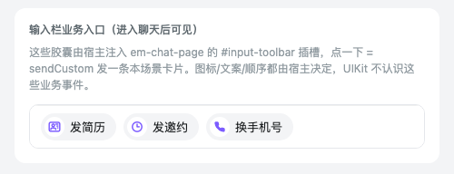
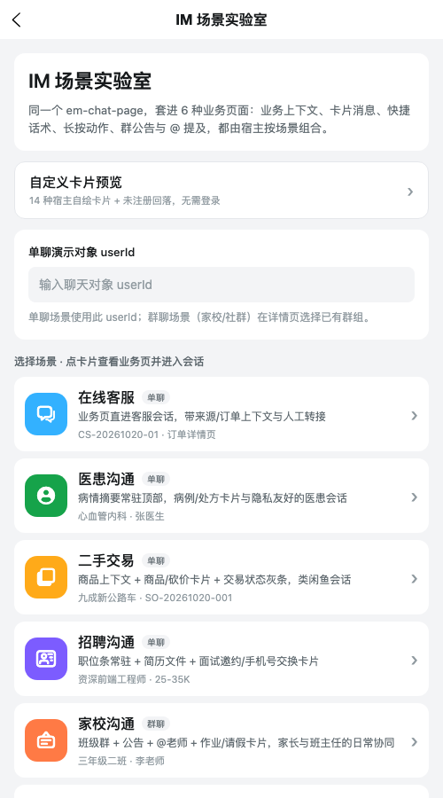
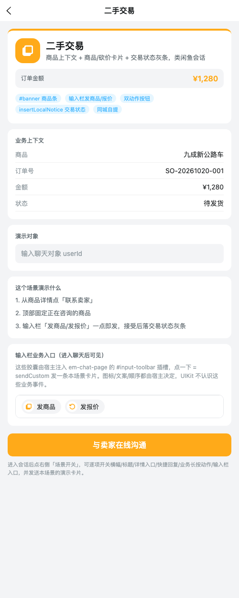
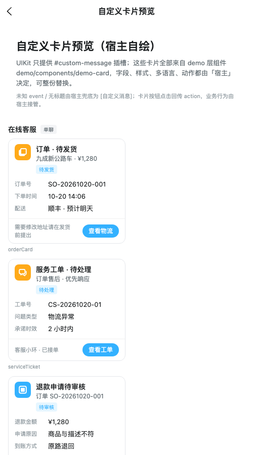

# 多场景接入：客服、医疗、招聘、二手交易

> [!TIP]
> **适用版本与目标读者**：适用版本 **1.0.0-rc.1**。适合已经跑通登录、想把 IM 嵌进业务页面的宿主开发者（H5 移动端 / 微信小程序 / App 三端同一套代码）。
>
> **这页解决什么问题**：**不做会话列表**，从业务入口直接进入 1v1 会话（或多客服群聊），并把订单号、病例、职位、商品这类业务上下文带进聊天页；同时按业务需要改标题、加固定业务条、加卡片消息、加常用话术和长按动作。

配套阅读：[聊天页](./PAGES-CHAT.md)（`em-chat-page` 全部契约）、[消息与扩展协议](./MESSAGING.md)（custom/ext/引用协议）、[EmKit API](./API-KIT.md)、[配置参考](./CONFIG.md)、[AI 流式消息](./AI-STREAM.md)、[示例工程](./DEMO.md)。

## 1. 接入模型（三步）

四个场景共享同一模型：宿主服务端为终端用户签发环信 token，客户端完成初始化与登录后，业务页直接 `navigateTo` 到含 `em-chat-page` 的自建页面。

```ts
import { EmKit } from '@/uni_modules/easemob-uikit-uni/libs'

// 1) 应用启动时初始化（appkey 只在 init 传一次）
EmKit.init({ appkey: 'your-appkey', primaryColor: '#009EFF' })

// 2) 拿到服务端签发的 userId + token 后登录
await EmKit.login({ userId: 'user-123', token: 'server-signed-token' })

// 3) 业务入口直进聊天页（对端 = 客服 / 医生 / HR / 卖家 userId）
uni.navigateTo({ url: '/sub-im/pages/chat/chat?conversationId=peer-user-id&chatType=singleChat' })
```

两个接入细节：

- **就绪门**：`EmKit.init` 返回后，SDK 模块可能仍在异步加载（微信小程序分包）。渲染聊天 UI 前可先 `await EmKit.whenReady()` 出加载态；`em-chat-page` 自身也有就绪门，历史与发送方法会等待就绪。
- **easycom**：页面级组件需要宿主 `pages.json` 配一条 custom 规则；原子组件（`em-avatar`、`em-badge` 等）走插件内置 easycom，零配置。

```json
{
  "easycom": {
    "autoscan": true,
    "custom": {
      "^em-([a-z-]+)-page$": "@/uni_modules/easemob-uikit-uni/components/pages/em-$1-page/em-$1-page.vue"
    }
  }
}
```

聊天页自带 `em-nav-bar`，页面样式需关闭原生导航（`navigationStyle: "custom"`，App 再加 `app-plus.titleNView: false`），否则出现双标题栏。页面根节点给 `height: 100%` 与 flex 链，详见 [快速开始](./QUICKSTART.md)。

## 2. 聊天页封装模板

自建页面只做路由参数解包与事件接线，聊天能力全部由 `em-chat-page` 提供：

```vue
<!-- pages/chat/chat.uvue -->
<template>
  <view class="page" :class="themeClass">
    <em-chat-page
      v-if="conversationId !== ''"
      :conversation-id="conversationId"
      :chat-type="chatType"
      :title="bannerTitle"
      :show-action="false"
      @send="onSend"
    >
      <!-- 固定业务条：不随消息滚动（医疗病情摘要 / 招聘职位 / 交易商品） -->
      <template #banner>
        <view class="biz-banner">
          <text class="biz-banner__title">{{ bannerTitle }}</text>
          <text class="biz-banner__desc">{{ bannerDesc }}</text>
        </view>
      </template>

      <!-- 自定义卡片消息：按 customEvent 分发，message 为 EmMessageItem（完整卡片见 §4.2） -->
      <template #custom-message="{ message }">
        <view class="biz-banner">
          <text class="biz-banner__desc">{{ message.customEvent }}</text>
        </view>
      </template>
    </em-chat-page>
  </view>
</template>

<script setup lang="ts">
import { ref } from 'vue'
import { onLoad } from '@dcloudio/uni-app'
import { EmKit, CONVERSATION_TYPE, mergeUserInfo, useTheme } from '@/uni_modules/easemob-uikit-uni/libs'
import type { ConversationTypeValue, EmMessageItem } from '@/uni_modules/easemob-uikit-uni/libs'

const { themeClass } = useTheme()
const conversationId = ref('')
const chatType = ref<ConversationTypeValue>(CONVERSATION_TYPE.SINGLE_CHAT)
const bannerTitle = ref('在线客服')
const bannerDesc = ref('服务单号 SO-20261020-001')

onLoad((query) => {
  // 只看是否已登录：断网重连中不踢回登录页，SDK 会自行重连
  if (EmKit.state.userId === '') {
    uni.reLaunch({ url: '/pages/login/login' })
    return
  }
  conversationId.value = (query?.['conversationId'] ?? '') as string
  chatType.value = query?.['chatType'] === CONVERSATION_TYPE.GROUP_CHAT
    ? CONVERSATION_TYPE.GROUP_CHAT
    : CONVERSATION_TYPE.SINGLE_CHAT
  // 不等 SDK 同步，进会话前灌对端昵称头像
  mergeUserInfo({ userId: conversationId.value, nickname: '在线客服', avatarUrl: '' })
})

function onSend(message: EmMessageItem): void {
  // 消息已由组件发出，这里只做埋点或业务联动
}
</script>

<style>
@import '@/uni_modules/easemob-uikit-uni/libs/style/variables.css';

.page {
  display: flex;
  flex-direction: column;
  height: 100%;
  background-color: var(--em-chat-bg);
}

.biz-banner {
  display: flex;
  flex-direction: column;
  padding: 8px 12px;
  background-color: var(--em-bg-secondary);
}
</style>
```

要点：

- `conversationId` / `chatType` 必填；单聊 `singleChat`，群聊 `groupChat`。
- `title` 覆盖导航标题（空串回落默认昵称链：单聊昵称 > userId，群聊群名 > groupId）；`showAction` 默认 `true`，为 `false` 时隐藏右上角详情入口，业务信息页由宿主接管。
- `#banner` 位于 nav-bar 与群公告条之间，高度与样式由宿主自管（建议 44–56px，不超过窗口高度 1/4）。

## 3. 能力速查表

| 业务诉求 | 能力 | 用法入口 |
|---|---|---|
| 从业务页直进 1v1 / 群聊 | 路由参数 + `em-chat-page` | §2 |
| 固定业务标题、隐藏详情入口 | `title` / `showAction` | §5.2 |
| 会话顶部固定业务条 | `#banner` 插槽 | §5.1 |
| 文本消息携带订单/来源上下文 | `EmKit.sendText` 的 `ext` 参数 | §4.1 |
| 商品卡、病例、处方、邀约等结构化消息 | `EmKit.sendCustom` + `#custom-message` 插槽 | §4.2 |
| 输入栏上方「发订单/发病例」业务入口 | `#input-toolbar` 插槽 | §4.3 |
| 常用话术胶囊 | `quickReplies` + `quickReplyMode` | §5.4 |
| 长按消息触发业务动作 | `extraMessageMenus` + `@message-menu` | §5.5 |
| 交易状态 / 转接 / 排队提示 | `EmKit.insertLocalNotice` | §5.3 |
| 业务入口未读角标 | `useConversationUnreadCount` / `EmKit.conversationUnreadCountOf` | §5.6 |
| 进会话前注入对端昵称头像 | `mergeUserInfo` | §5.6 |
| AI 客服流式回复 | `enableStreamMessage` + `#stream-message` | §6 |

## 4. 业务上下文与卡片消息

### 4.1 文本消息携带业务 ext

直进会话时把订单/商品/来源页带给对端，随文本消息一起发送：

```ts
await EmKit.sendText(
  peerUserId,
  'singleChat',
  '你好，我想咨询这个订单',
  undefined,                 // 引用（可选）
  undefined,                 // @提及 userId 列表（可选，群聊用）
  { orderId: 'SO-20261020-001', source: 'order-detail', sku: 'A-100' }
)
```

接收侧从 `message.ext` 读取。约束：

- `ext` 必须 JSON 可序列化；空对象等价于不挂 `ext`。
- `msgQuote`（引用主协议）、`emQuote`（0.x 兼容字段，1.0 发送双写）与 `em_at_list`（@提及）是 UIKit 自身保留的 key，**业务 ext 不能覆盖**；同时存在时以 UIKit 的 key 为准。

### 4.2 自定义卡片消息（`sendCustom` + `#custom-message`）

商品卡、病例、处方、面试邀约、手机号交换、砍价等结构化消息走自定义消息。UIKit 负责「发得出、收得到、有插槽」；卡片长什么样、字段怎么排、文案用什么语言，全部由宿主决定。

**发送**：`sendCustom(event, params?, ext?)`。`params` 只放字符串（wire 协议字段），结构化内容放 `ext`：

```ts
await EmKit.sendCustom(
  peerUserId,
  'singleChat',
  'productCard',                    // 宿主自定义事件名
  { productId: 'P-9527' },          // wire params：跨端/服务端互通
  {                                 // ext：结构化业务载荷（JSON 可序列化）
    title: '九成新公路车',
    price: '¥1,280',
    orderId: 'SO-20261020-001'
  }
)
```

**渲染**：聊天页 `#custom-message` 插槽（作用域 `message`），注入宿主自己的卡片组件：

```vue
<em-chat-page :conversation-id="id" :chat-type="chatType">
  <template #custom-message="{ message }">
    <my-card :message="message" fallback-text="[自定义消息]" @action="onCardAction" />
  </template>
</em-chat-page>
```

宿主卡片组件完全属于宿主工程，可任意布局、动画、图片与多语言：

```vue
<!-- components/my-card/my-card.vue -->
<template>
  <view v-if="card != null" class="my-card">
    <image v-if="card.image !== ''" :src="card.image" class="my-card__cover" />
    <text class="my-card__title">{{ card.title }}</text>
    <view class="my-card__actions">
      <view class="my-card__btn" @click="onOpen">{{ t('card.open') }}</view>
    </view>
  </view>
  <view v-else class="my-card my-card--fallback">
    <text class="my-card__title">{{ fallbackText }}</text>
  </view>
</template>
```

`message` 上可直接取：

| 字段 | 说明 |
|---|---|
| `message.type` | `MESSAGE_TYPE.CUSTOM`（`'custom'`） |
| `message.customEvent` | 业务事件名（wire `body.event`），宿主据此分发卡片 |
| `message.customParams` | 字符串参数表（wire `body.params`） |
| `message.ext` | 结构化业务载荷（与服务端/其它 UIKit 下发的 custom 消息互通） |
| `message.rawType` | `custom` 消息为 `'custom'`；未识别 wire 类型时为该类型原文 |
| `message.self` | 是否己方发送（可做左右不同样式） |

样式、多语言与交互：

- **样式**：卡片用宿主自己的 CSS 或设计系统；想跟随 UIKit 明暗主题时消费 `--em-*` 设计变量（`--em-bg-base`、`--em-text-primary`、`--em-border-color` 等），主题类挂在页面根节点即可生效，见 [设计变量](./DESIGN-TOKENS.md)。单卡宽度与间距建议在宿主页面用外层 `view` 包裹控制，五端最稳。
- **多语言**：UIKit 不产生卡片文案，`useLocale()` 在宿主组件里照常可用。跨语言收发时建议 `ext` 存业务 code（如 `status: 'pending'`），由接收端翻译成当前语言，而不是直接存中文句子。
- **动作**：卡片里的按钮直接走宿主自己的事件与路由，无需 UIKit 参与。
- **长按**：`#custom-message` 外层容器把原生 longpress 冒泡给消息菜单，卡片内容长按也能唤起「复制 / 引用 / 删除 / 业务动作」。`MESSAGE_TYPE.CUSTOM` 的复制与引用摘要回落为 i18n `message.custom`。
- **未知 event 与解析失败**：由宿主决定呈现，示例工程回落 `[自定义消息]` 灰色气泡；`#custom-message` 也会收到未识别的 wire 类型，可按 `message.rawType` 再做分支。
- **为什么卡片只留插槽**：卡片布局、字段与多语言随业务差异极大，内置 schema 必然不够；uni-app x 五端也无法动态实例化宿主组件。UIKit 保证收发通道稳定，呈现完全下沉。

示例工程的宿主侧参考实现是 `demo/components/demo-card`（14 种卡片、双动作、手机号脱敏、未知事件回落）与免登录预览页 `sub-im/pages/scenario/cards`，可直接复制到业务项目后改样式。

### 4.3 输入栏业务入口（`#input-toolbar`）

发送侧入口不一定要藏在面板里。更贴近业务的做法是在输入栏上方放一条场景胶囊条：客服「发订单 / 发工单」、医生「发病例 / 发处方」、HR「发简历 / 发邀约 / 换手机号」，点一下就把对应自定义消息发出去。UIKit 只给固定位，胶囊长什么样、有哪些、点了发什么，全是宿主代码。

```vue
<em-chat-page :conversation-id="id" :chat-type="chatType">
  <template #input-toolbar>
    <my-composer-bar :items="composerItems" @select="onComposerSelect" />
  </template>
</em-chat-page>
```

```ts
const composerItems = [
  { key: 'orderCard', label: '发订单', icon: 'cart-filled' },
  { key: 'serviceTicket', label: '发工单', icon: 'board' }
]

function onComposerSelect(key: string): void {
  const card = MY_CARDS.find((item) => item.event === key)
  if (card == null) return
  EmKit.sendCustom(peerUserId, 'singleChat', card.event, card.params, card.ext)
}
```

- **位置**：插槽在消息列表与输入栏之间（快捷回复条之上），随软键盘一起上移，不参与消息滚动；不注入就不占高度。
- **开关**：入口显隐由宿主 `v-if` 控制（如仅坐席端可见、仅特定工单状态出现），`em-chat-page` 不感知入口存在。
- **边界**：UIKit 不提供胶囊样式、图标语义、入口排序与点击后的发送逻辑；入口文案走宿主自己的 i18n。
- **发送即卡片**：点一下 = 一次 `sendCustom`，对端仍由 `#custom-message` 渲染（§4.2），两个插槽互不依赖。
- **数量**：入口多时宿主自备横向 `scroll-view`；移动端建议 2–4 个高频入口，其余收进「更多」。

示例工程参考：`demo/components/demo-composer-bar`（横向胶囊条）+ `demo/sub-im/pages/chat/chat.uvue` 的 `#input-toolbar` 接线；入口清单来自场景目录里每条卡片的 `entryLabel` / `entryIcon`，新增一种卡片就自动多一个入口。



## 5. 会话页改造点

### 5.1 顶部业务条（`#banner`）

固定位、不随消息滚动，适合长期展示的会话上下文：

| 场景 | banner 内容 |
|---|---|
| 客服 | 来源渠道 / 服务单号 |
| 医疗 | 诊断与过敏史摘要、问诊单号 |
| 招聘 | 职位名 + 薪资，点击跳职位详情（宿主接路由） |
| 二手交易 | 正在咨询的商品（图 + 标题 + 价格） |

### 5.2 导航标题与详情入口（`title` / `showAction`）

- **客服**：`title="在线客服"`、`:show-action="false"`，不暴露对端资料与免打扰、删除会话等 C 端操作；业务信息页由宿主自己提供。
- **多客服 / 问诊团队（群聊）**：`:show-member-count="false"`、`:show-announcement="false"`、`sender-name-mode="hidden"`、`:enable-mention="false"`，配合 `:show-action="false"`，由宿主提供「服务信息」页。

`sender-name-mode` 取 `EmSenderNameMode`（`always` / `hidden`），仅群聊生效。

### 5.3 系统提示消息（`insertLocalNotice`）

居中小灰条，**只插本地、不发服务端、不进对方会话**，用于交易状态、转接、排队提示：

```ts
EmKit.insertLocalNotice(peerUserId, 'singleChat', '对方已拍下，等待付款')
// 群聊别名（等价）：EmKit.insertGroupNotice(groupId, '客服小环已接入')
```

- 渲染形态复用 `MESSAGE_TYPE.NOTICE`：居中 chip、无头像无气泡、长按菜单禁用。
- 本地条目在 `loadHistory` 合并时保留（重进会话拉历史不会丢）；清空聊天记录或登出时随消息缓存清除；进程重启后不保留（纯内存态）。
- 只对当前设备当前账号可见。需要跨端留痕的状态请走服务端自定义消息或系统通知。

### 5.4 快捷回复（`quickReplies` / `quickReplyMode`）

常用语胶囊渲染在输入栏上方，横向滚动；点击行为由 `quickReplyMode` 决定：

```ts
import type { EmQuickReply } from '@/uni_modules/easemob-uikit-uni/libs'

const QUICK_REPLIES: EmQuickReply[] = [
  { label: '期望薪资', text: '我的期望薪资是 15-20K' },
  { label: '到岗时间', text: '我可以在两周内到岗' },
  { label: '方便沟通', text: '您好，请问现在方便沟通吗？' }
]
```

```vue
<em-chat-page
  :conversation-id="conversationId"
  :chat-type="chatType"
  :quick-replies="QUICK_REPLIES"
  quick-reply-mode="fill"
/>
```

- `fill`（默认）：点击**替换当前草稿**（整句替换，不与半句拼接），用户可编辑后发送；`send`：点击直接发送，不挂引用与 @提及。
- `EmQuickReply.text` 缺省时用 `label`。
- 空数组不渲染；全员禁言的群聊自动隐藏；文案由宿主提供，不占用 UIKit 的 i18n 表。

### 5.5 业务长按菜单动作（`extraMessageMenus`）

在内置菜单（复制 / 引用 / 撤回 / 删除）之后追加业务动作，命中时 emit `message-menu(key, message)`：

```ts
import { MESSAGE_TYPE } from '@/uni_modules/easemob-uikit-uni/libs'
import type { EmMessageMenuExtra, EmMessageItem } from '@/uni_modules/easemob-uikit-uni/libs'

const EXTRA_MENUS: EmMessageMenuExtra[] = [
  { key: 'view-order', text: '查看订单', icon: 'doc', types: [MESSAGE_TYPE.CUSTOM] },
  { key: 'view-prescription', text: '查看处方', icon: 'doc' }
]

function onMessageMenu(key: string, message: EmMessageItem): void {
  if (key === 'view-order') {
    uni.navigateTo({ url: `/pages/order/detail?id=${String(message.ext.orderId ?? '')}` })
  }
}
```

```vue
<em-chat-page
  :conversation-id="conversationId"
  :chat-type="chatType"
  :extra-message-menus="EXTRA_MENUS"
  @message-menu="onMessageMenu"
/>
```

约束：

- 业务项追加在内置项之后、删除项之前（删除保持末位）；内置 key（`copy` / `quote` / `recall` / `delete`）保留，同名业务项会被忽略。
- `types` 缺省表示所有消息类型；系统提示灰条（`NOTICE`）不出现长按菜单。
- `icon` 取 `em-icon` 字形名；`text` 由宿主提供。
- 自定义卡片（`#custom-message` 里的宿主内容）同样支持长按：卡片内的原生 `longpress` 会冒泡到消息行，无需额外接线。

### 5.6 对端资料与入口未读角标

```ts
import { mergeUserInfo, useUnreadCounts, useTabBarBadge, useConversationUnreadCount } from '@/uni_modules/easemob-uikit-uni/libs'

// 不等 SDK 同步，进会话前直接灌客服/医生/HR 的昵称头像
mergeUserInfo({ userId: peerUserId, nickname: '在线客服', avatarUrl: 'https://example.com/avatar.png' })

const { conversationUnread } = useUnreadCounts()            // 响应式总未读
useTabBarBadge({ conversationIndex: 0 })                     // 原生 tabBar 角标
const peerUnread = useConversationUnreadCount(peerUserId)    // 单会话未读（业务入口角标）
```

- 非 tabBar 入口（业务页按钮）直接用 `conversationUnread.value` / `peerUnread.value` 渲染 `em-badge`。
- `useConversationUnreadCount` 也接受 `ref`（动态会话 id）；非 setup 场景用 `EmKit.conversationUnreadCountOf(conversationId)` 取快照。

### 5.7 业务资料注入（`set*Presentation`）

宿主业务资料（CRM 昵称、员工头像、群名标签）经三个注入 API 写入，优先于 SDK 资料参与全库回落链；注入层与 SDK 数据分层存储，资料回推与会话快照刷新不会冲掉注入值。写入即响应式更新：

```ts
// 单聊：对端显示业务昵称；会话标题/列表旁挂业务标签（ext 随插槽 scope 透出）
EmKit.setUserPresentation(peerId, { nickname: '张医生（皮肤科）' })
EmKit.setConversationPresentation(peerId, { ext: { tag: '复诊' } })

// 群聊：群名旁打标签（会话列表、聊天页标题、群详情页同步生效）
EmKit.setGroupPresentation(groupId, { ext: { tag: '3 床家属群' } })
```

标签等扩展 UI 由宿主经插槽自绘——注入只负责数据与优先级：

```vue
<!-- 聊天页：整标题自绘（名称 + 业务标签） -->
<em-chat-page :conversation-id="id" :chat-type="chatType">
  <template #title="{ name, ext }">
    <view class="title-row">
      <text class="title-text">{{ name }}</text>
      <view v-if="ext?.tag" class="title-tag"><text class="title-tag-text">{{ ext.tag }}</text></view>
    </view>
  </template>
</em-chat-page>

<!-- 会话列表：条目标题旁追加标签 -->
<em-conversation-page @select="onSelect">
  <template #title-extra="{ ext }">
    <view v-if="ext?.tag" class="row-tag"><text class="row-tag-text">{{ ext.tag }}</text></view>
  </template>
</em-conversation-page>

<!-- 群详情页：群名旁追加标签 -->
<em-chat-info-page :conversation-id="groupId" :chat-type="CONVERSATION_TYPE.GROUP_CHAT">
  <template #group-name-extra="{ ext }">
    <view v-if="ext?.tag" class="name-tag"><text class="name-tag-text">{{ ext.tag }}</text></view>
  </template>
</em-chat-info-page>
```

清除注入传 `null`（如退出业务态时还原默认展示）：`EmKit.setConversationPresentation(peerId, null)`。登出/换账号后注入清空，在 `login` 成功后重新注入。API 细节见 [EmKit 门面](./API-KIT.md)。

## 6. AI 流式回复

AI 客服的常见形态：业务服务端调用模型 → 经环信 RESTful 下发流式消息 → 客户端 SDK `onStreamMessage` 接收。UIKit 内置分片合并、合批重绘、丢片补偿与纯文本光标，接入方无需写渲染代码：

```ts
EmKit.init({
  appkey: 'your-appkey',
  enableStreamMessage: true,  // 默认 true；关闭后等完整消息一次上屏
  streamThrottle: 50          // 合批间隔 ms；0 = 逐片即写
})
```

markdown 等富格式气泡由 `#stream-message` 插槽接管（不接管时回落纯文本气泡，内容仍随分片增长）：

```vue
<em-chat-page :conversation-id="id" :chat-type="chatType">
  <template #stream-message="{ message }">
    <my-markdown-bubble :message="message" />
  </template>
</em-chat-page>
```

外部 AI 面板需要同步展示生成过程时，订阅 `EmKit.onStreamMessage(handler)`（分片已合批，`msg.stream.fullText` / `status` 为最新值；页面卸载必须取消订阅）。生产环境不要把模型 API Key 放前端。完整能力见 [AI 流式消息](./AI-STREAM.md)。

## 7. 四场景配方

| 场景 | 推荐组合 | 多人服务形态 |
|---|---|---|
| 客服 | `title="在线客服"` + `:show-action="false"` + `sendText` ext 带来源/订单 + `sendCustom('serviceTicket' / 'refundReview')` 工单与退款卡 + `quickReplies` 话术 + `insertLocalNotice` 转接提示 + AI 流式回复 | 共享客服账号单聊；需要区分坐席时用群聊（见下行） |
| 医疗 | `#banner` 病情摘要 + 图片/文件报告（App 需注册附件能力）+ `sendCustom('medicalCase' / 'prescription')` 病例与处方卡 + 已读回执 + `extraMessageMenus`「查看处方」 | 真群，保留昵称行区分主治与助手 |
| 招聘 | `#banner` 职位条 + 简历文件 + `sendCustom('interviewInvite' / 'phoneExchange')` 邀约与手机号交换卡 + `quickReplies` 常用语 | 单聊即可 |
| 二手交易 | `#banner` 商品条 + `sendCustom('productCard' / 'priceOffer')` + `insertLocalNotice` 交易状态 + `extraMessageMenus`「查看订单」 | 买卖单聊；平台仲裁可用三人群 |

高频发卡入口建议直接放 `#input-toolbar`：客服（发订单 / 发工单 / 退款审核）、医疗（发病例 / 发处方）、招聘（发简历 / 发邀约 / 换手机号）、交易（发商品 / 发报价）、家校（发作业 / 请假审批）、社群（发活动 / 装备清单）。

## 8. 平台边界

| 能力 | H5 移动端 | 微信小程序 | App |
|---|---|---|---|
| 图片/拍照 | 可用 | 可用 | 可用 |
| 文件（PDF / 简历）发送 | 可用 | 可用 | 需宿主注册附件 provider 且当前可用；未注册或不可用时入口隐藏 |
| 文件打开 / 下载 | 未接入，文件气泡为纯展示 | 同左 | 同左 |
| 录音与语音消息 | 仅接收播放（录音入口隐藏） | 可用 | 可用 |
| 视频消息 | 可发送与播放（浏览器文件选择，宽高与时长由浏览器解析） | 可发送与播放（内置全屏播放器） | 同小程序 |
| 软键盘避让 | 浏览器自管 | 输入栏按键盘高度上推 | 输入栏按键盘高度上推 |

- 平台能力差异由 `PLATFORM_CAPABILITIES`（`videoPreview` / `filePick` / `fileOpen`）集中判定，其中 `PLATFORM_CAPABILITIES.filePick` 只表示是否有内置选择器。宿主判断当前能否选择文件应使用 `EmKit.canPickAttachment`（或响应式 `canPickAttachment()`）：App 注册且 provider 可用时为 true，未注册或不可用时为 false；不要只依据常量隐藏自己的入口。
- 位置消息未内置类型：把经纬度放进 `sendCustom` 的 `ext`，由宿主卡片渲染。
- 需要更细的端间差异与替代方案，见 [平台能力与差异](./PLATFORM.md)。

## 9. 示例工程

`demo` 工程内置「IM 场景实验室」，用同一套 `em-chat-page` 组合出 6 种业务页面：

| 场景 | 会话形态 | 主要演示 |
|---|---|---|
| 在线客服 | 单聊 | 业务页直进、来源/工单横幅、工单与退款卡、快捷话术、转接灰条 |
| 医患沟通 | 单聊 | 病情摘要 `#banner`、报告图片/文件、病例与处方卡（仅医生可见角标） |
| 二手交易 | 单聊 | 商品条、商品与砍价卡、双动作按钮、交易状态灰条 |
| 招聘沟通 | 单聊 | 职位条、常用语、简历文件、面试邀约与手机号交换（宿主组件脱敏） |
| 家校沟通 | 群聊 | 班级公告、@老师、成员昵称行、作业卡、请假审批卡 |
| 兴趣社群 | 群聊 | 群公告、@群主、活动卡、装备清单卡 |





体验路径：

1. 「我的」→「IM 场景实验室」→ 选一个场景卡片（详情页展示业务上下文、能力点、演示对象）；
2. 单聊场景填对端 userId（或点最近会话），群聊场景选一个已有群组；点底部主按钮进入会话；
3. 会话页点右侧「场景开关」浮钮，七项能力实时生效：业务横幅 / 场景标题 / 隐藏详情入口 / 快捷回复条 / 常用语直接发送 / 业务长按动作 / 输入栏业务入口；
4. 输入栏上方的场景胶囊（`#input-toolbar`）一点即发对应卡片；也可在面板内发送本场景的 2–3 种卡片（`sendCustom`，聊天页 `#custom-message` 注入宿主 `demo-card`）、带业务 ext 的文本（`sendText`）、系统提示（`insertLocalNotice`）；点卡片按钮由宿主弹窗展示回传动作；「未知事件」演示宿主回落；长按卡片或气泡触发业务菜单；顶部实时显示本会话与总未读。

免登录看卡片：列表页顶部「自定义卡片预览」→ `sub-im/pages/scenario/cards`，用宿主 `demo-card` 直接渲染 14 种卡片与未知事件回落：



14 种卡片与「未知事件 → [自定义消息]」的完整长图见 [scene-lab-cards-all.png](assets/scene-lab-cards-all.png)（含 5 种视觉族、字段/角标/主次按钮与手机号脱敏）。

架构：场景数据集中在 `demo/common/scenario-catalog.ts`（业务字段、能力点、横幅、话术、入口胶囊文案、每场景 2–3 条卡片的 event/params/ext、菜单），卡片解析在 `demo/common/demo-card-data.ts`，呈现组件在 `demo/components/demo-card`（均为宿主侧代码，不进 UIKit）；列表页 `scenario.uvue` → 详情页 `detail.uvue` → 共享聊天页 `chat.uvue?scenario=<key>`。**新增场景只需加一条 catalog 配置 + 一条宿主卡片分支，不复制聊天页**——这正是 UIKit 可组合性的演示。

---

*相关页面：[聊天页](./PAGES-CHAT.md) · [消息与扩展协议](./MESSAGING.md) · [EmKit API](./API-KIT.md) · [配置参考](./CONFIG.md) · [设计变量](./DESIGN-TOKENS.md) · [示例工程](./DEMO.md)*
